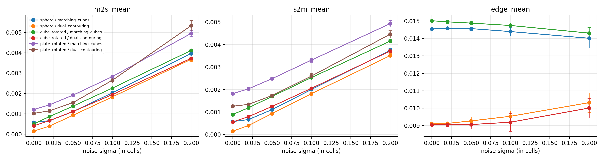
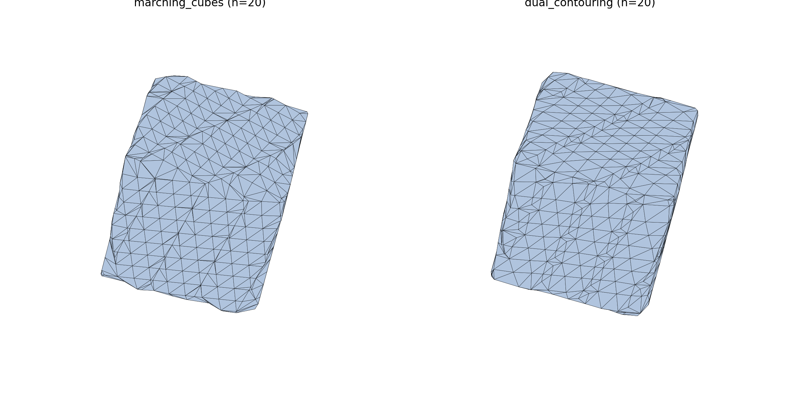

# Isosurface Extraction from SDF Samples: Marching Cubes vs. Classic Dual Contouring

A small re-implementation exercise in NumPy. It implements **classic Dual Contouring (DC)** on signed-distance samples, with surface normals **estimated from the grid by finite differences**, and compares it with Marching Cubes (scikit-image) on analytic shapes with known ground truth: mesh accuracy, sharp-edge preservation, noise robustness, and an ablation on normals and QEF regularization.

**This is not the method of** *Dual Contouring of Signed Distance Data* (Carrera, Wang, Batty, Stein, Sellán, SIGGRAPH NA 2026), which works from distance data without supplied normals. It is a baseline study of the classic algorithm only; nothing here reproduces or evaluates that paper.

CPU only; the whole notebook runs in about a minute.

## Setup

- **Shapes (exact SDFs, domain [-1, 1]^3):** a sphere (r = 0.6), a cube with edges rotated off the grid axes (half-extent 0.5), and a thin rotated plate (half-extents 0.5 x 0.5 x 0.03, thickness 0.06).
- **Grids:** n = 16, 24, 32, 48, 64, 96 cells per axis (cell size h = 2/n).
- **DC details:** edge crossings by linear interpolation of the SDF; normals from `np.gradient` of the grid, trilinearly interpolated; per-cell QEF minimising the squared normal-plane residuals plus a regularisation term toward the mean crossing (reg = 0.1 unless stated), solution clamped to the cell; quads oriented by the gradient.
- **Metrics (units of the domain):** mesh to surface (exact, from the analytic SDF at area-weighted mesh samples); surface to mesh (exact point-to-triangle distance); true edge points to mesh (sharp-edge preservation; cube and plate only). Also the fraction of mesh edges shared by exactly two triangles (manifold fraction).
- **Noise:** i.i.d. Gaussian on the SDF samples, standard deviation sigma x h, at n = 48, five draws per setting (one at sigma = 0).

## Sanity checks (n = 48)

| Shape | Method | Volume error | Manifold fraction |
|---|---|---|---|
| sphere | Marching Cubes | -0.29% | 1.0000 |
| sphere | Dual Contouring | +0.04% | 1.0000 |
| cube | Marching Cubes | -0.40% | 1.0000 |
| cube | Dual Contouring | -0.20% | 1.0000 |
| plate | Marching Cubes | -5.33% | 1.0000 |
| plate | Dual Contouring | -2.30% | 0.9996 |

## Results

Log-log slopes of error against h (fits over n >= 24): sphere 2.0 for both methods (mesh-to-surface 2.00 MC, 1.97 DC); rotated cube surface errors about 2 for both; **cube edge error about 1.0 for both** (1.00 MC, 1.02 DC). The plate is not fitted: its thickness (0.06) is below one cell for n <= 32, so the curves change regime between n = 32 and n = 48 and a single slope is meaningless there.

DC error as a fraction of Marching Cubes error (same grid):

| Shape | mesh to surface | surface to mesh | edge error |
|---|---|---|---|
| sphere | 0.24-0.27 at every n | 0.25-0.27 | n/a |
| rotated cube | 0.70-0.81 | 0.62-0.65 | 0.63-0.66 |
| plate, n >= 48 | 0.82-1.01 | 0.65-0.77 | 0.60-0.62 |
| plate, n <= 32 (under-resolved) | 0.93-1.15 | 0.88-0.95 | 0.84-0.91 |

At n = 32 the DC plate mesh has manifold fraction 0.965; every other configuration is at least 0.9987.

Noise (n = 48), means over five draws; mesh-to-surface error and edge error:

| Shape / method | sigma = 0 | sigma = 0.1 | sigma = 0.2 | manifold fraction at 0.2 |
|---|---|---|---|---|
| sphere / MC | 0.00057 | 0.00203 | 0.00396 | 1.0000 |
| sphere / DC | 0.00015 | 0.00183 | 0.00368 | 0.9979 |
| cube / MC | 0.00050 | 0.00226 | 0.00411 | 1.0000 |
| cube / DC | 0.00041 | 0.00194 | 0.00372 | 0.9957 |
| plate / MC | 0.00121 | 0.00283 | 0.00495 | 1.0000 |
| plate / DC | 0.00102 | 0.00265 | 0.00533 | 0.9897 |

Edge error (cube): MC 0.01454 to 0.01401, DC 0.00912 to 0.01032 (sigma 0 to 0.2).

### Ablation on the rotated cube (edge error, mean over true edge points)

| n | Marching Cubes | DC, grid normals (reg 0.01) | DC, grid normals (reg 0.1) | DC, **oracle** analytic normals |
|---|---|---|---|---|
| 32 | 0.02168 | 0.01286 | 0.01368 | 0.00555 |
| 64 | 0.01092 | 0.00661 | 0.00697 | 0.00293 |
| 96 | 0.00732 | 0.00438 | 0.00462 | 0.00194 |

Regularisation strengths of 0.001-0.1 changed the edge error by only a few percent; reg = 1 was worse (n = 96: 0.00580). Oracle normals are not available for real SDF data.

## What this shows

- On the sphere, DC's error is about a quarter of Marching Cubes' at every resolution while both converge at second order.
- On sharp features, DC reduces edge error by roughly 35-40% relative to Marching Cubes at every resolution above the plate's resolution threshold, but **edge error still decreases only linearly with h for both methods**.
- Oracle normals cut DC's edge error by about 2.4x relative to grid-estimated normals, yet the error still fell only about linearly with h (0.00555 to 0.00194 from n = 32 to 96). Normal estimation therefore accounts for part of the edge error, not all of it; remaining causes (for example crossing placement near edges, cell clamping, corners) were not tested.
- Under noise, both methods degrade roughly linearly in sigma. DC's advantage in surface error shrinks (cube mesh-to-surface ratio about 0.82 at sigma = 0, 0.91 at 0.2) and reverses for the plate at sigma = 0.2 (DC 0.00533 +/- 0.00026 vs MC 0.00495 +/- 0.00015). DC's edge error grows with noise while Marching Cubes' does not, and DC produces slightly non-manifold meshes (about 0.2-1% of mesh edges at sigma = 0.2, depending on the shape).

## Limitations

- Three analytic shapes, no CSG shapes, no real scans; results may not transfer.
- Classic DC with a simple QEF, not the paper's method.
- Noise is i.i.d. Gaussian; real SDF errors are structured. Five draws per noise setting, standard deviations across draws only.
- Edge preservation is measured only at the true edges of the cube and plate.
- The thin plate is under-resolved for n <= 32, so its small-n numbers and fitted slopes should not be interpreted.
- The oracle-normals result shows an association, not the cause of the remaining error.

## Reproduce

Run `SDF_Isosurface_MC_vs_DC.ipynb` top to bottom (CPU is enough). It writes `results_resolution.csv`, `results_noise.csv`, `results_ablation.csv` and the figures.

## License

MIT (see `LICENSE`).
